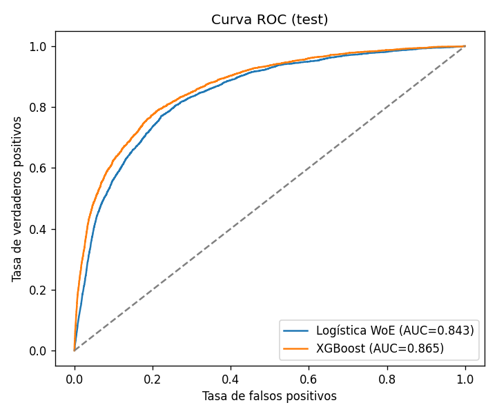
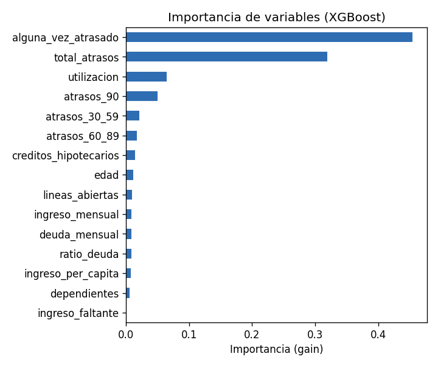

# Credit Scoring: SQL + Regresión logística (WoE) + XGBoost

Modelo de **probabilidad de default (PD)** para el otorgamiento de créditos, con el flujo que se usa en riesgo de crédito bancario:

1. **Extracción y construcción de variables en SQL** (SQLite): limpieza, variables nuevas, funciones de ventana.
2. **Binning, WoE e Information Value** para seleccionar variables.
3. **Dos modelos:** regresión logística sobre WoE (estándar regulatorio, interpretable) y **XGBoost** (machine learning).
4. **Validación fuera de muestra:** AUC, Gini y KS.
5. **Scorecard** en puntos (600 puntos = odds 50:1, PDO = 20) y **punto de corte** con tasa de aprobación.

## Datos
[Give Me Some Credit (Kaggle)](https://www.kaggle.com/c/GiveMeSomeCredit): 150,000 clientes; la variable objetivo es si el cliente cayó en mora de 90+ días en los 2 años siguientes. Ver `data/README.md`.

## Estructura
```
data/        CSV de Kaggle y base SQLite (no se suben)
sql/         02_variables.sql (feature engineering), 03_exploracion.sql (análisis)
src/         01_cargar_sqlite.py, 02_crear_variables.py, woe.py, 03_entrenar.py
reports/     métricas, IV, predicciones y gráficos
```

## Cómo correrlo
```bash
pip install -r requirements.txt
python src/01_cargar_sqlite.py
python src/02_crear_variables.py
python src/03_entrenar.py
```

## Resultados (muestra de prueba, 30%)
| Modelo | AUC | Gini | KS |
|---|---|---|---|
| Logística WoE | 0.843 |0.687 | 0.548 |
| XGBoost | 0.865 | 0.729 |0.576|




## Autor
Josué Cárdenas Barrantes · [LinkedIn](https://www.linkedin.com/in/josue-david-cardenas-barrantes-2943b9407)
